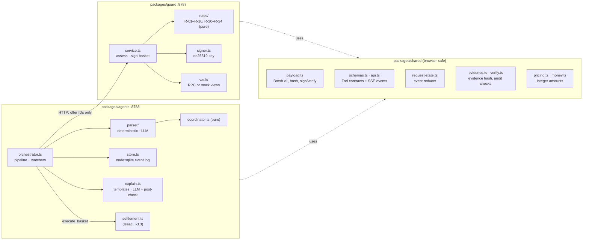

# Architecture: the off-chain half (Guard, agents, shared)

How the TypeScript code maps onto PRD §6. The system diagrams and DFDs are in the [README](../README.md#5-system-overview); this page is about where each guarantee lives in the code.

## Where each guarantee lives

| Guarantee | Enforced in | Tested in |
|---|---|---|
| Payload bytes are identical in Rust and TS | `shared/src/payload.ts` + `vectors/basket-v1.json` (cross-checked against Rust borsh 1.x) | `shared/test/payload.test.ts` |
| Prices come from the evidence store, never the caller | `guard/src/server.ts` (`findPriceKeys` → 400), `service.ts` rebuilds amounts from offer IDs | `guard/test/service.test.ts` |
| Rules are pure, integer-only and deterministic | `guard/src/rules/` (clock is an input; lint bans floats there) | `guard/test/rules.test.ts` (AT-02 boundaries) |
| Guard fails closed | `service.ts` → 503 on any Vault read failure or Vault/Guard mismatch | AT-14 tests in `service.test.ts` and `pipeline.test.ts` |
| The Guard secret never leaks | `signer.ts` (private field, safe `toJSON`/inspect), `logger.ts` (redaction) | `service.test.ts` "never appears in logs" |
| Guard and agents compute the same amounts | `shared/src/pricing.ts`, used by both | Agents cross-check Guard's signed payload against their own plan before asking for approval |
| The LLM decides nothing | Parser output is pinned to catalogue keys; explanations are post-checked for unknown numbers, IDs, URLs and banned phrases; the LLM never sees `raw_text` | `parser-coordinator.test.ts`, AT-13 in `pipeline.test.ts` |
| Every step is replayable and auditable | `store.ts` (event log), `request-state.ts` (one reducer for service and UI), `evidence.ts` | `pipeline.test.ts`, `scripts/verify-audit.test.ts` |
| The Vault re-checks everything | Isaac's contract | `contracts/vault/tests` (to come) |

## Request lifecycle in the agents service

1. `POST /v1/requests` → `request.created`.
2. **Parse** (`parser/`): the deterministic parser by default; the LLM parser (Groq) when `LLM_PROVIDER=groq` and `GROQ_API_KEY` are set, falling back to deterministic on any LLM error.
3. **Research**: every snapshot offer for the matched items → `research.offer`.
4. **Assess**: Guard `POST /v1/assess` with offer IDs → `policy.verdict` per offer, then `explain.verdict`.
5. **Plan** (`coordinator.ts`): the cheapest combination of ALLOW and acknowledged-REVIEW offers within `max_vendors` (read live from the Vault). The evidence core is hashed and stored → `coordinator.basket`. If a line needs acknowledgement → `coordinator.needs_ack`, and the request waits for `POST /acknowledge`, which re-runs this step.
6. **Sign**: Guard `POST /v1/sign-basket`. The agents decode Guard's payload and check its hash, evidence hash, total and basket ID against their own plan → `guard.signed` (or `guard.refused`).
7. **Approval watch**: poll `get_approval(hash)` every 2 s until `expires_at_ms` → `approval.seen` or `approval.expired`. A newer basket (after an acknowledgement) or a cancel stops the old watcher (generation counter).
8. **Settle**: `settlement.execute` → `settlement.submitted`; poll `get_basket` → `settlement.payout` per final payout → `settlement.final`. Chain results are attached to the evidence bundle.

On restart, `orchestrator.resume()` re-attaches watchers to requests still awaiting approval.

## Trust boundaries in code

- **The web app** gets everything through the agents API or chain views and should re-verify locally: decode `payload_b64` with `decodePayload`, recompute the hash with `basketHashHex`, and check the bundle with `verifyEvidenceBundle`. All three are browser-safe exports of `@checkpoint/shared`.
- **The agents service** holds no Guard key and no owner key; the only key it will hold is the Settlement Agent's function-call key, inside `settlement.ts`. It is not trusted for prices: Guard reloads every offer by ID.
- **Guard** holds the ed25519 key and reads the Vault over RPC. It is not trusted to enforce caps on its own; the Vault re-checks them.
- **The LLM client** (`llm.ts`) lives in the agents service, sees only catalogue keys, list text and structured findings, and has no path to any key or to the signer.
